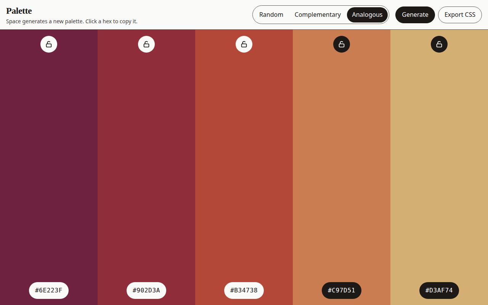

# Palette

A single-page color palette generator for designers. It builds a five-color palette, lets you lock the swatches you want to keep, copy hex codes, and export the set as CSS variables.

Made for MLH Global Hack Week: Builders Week, for the challenge "Use GitHub Copilot to Build a Simple Application."

## Features

- Generate **random**, **complementary**, and **analogous** palettes
- Lock any swatch so the next generate keeps it
- Copy a hex code with one click
- Export the palette as CSS custom properties
- Press Space to generate when focus is not in a control

## How to run

No build step and no dependencies. From this directory:

```bash
python3 -m http.server 8080
```

Open [http://localhost:8080](http://localhost:8080).

Opening `index.html` directly also works. Copy and export are most reliable over HTTP.

Check the color math with:

```bash
node palette.js
```

## Screenshot


